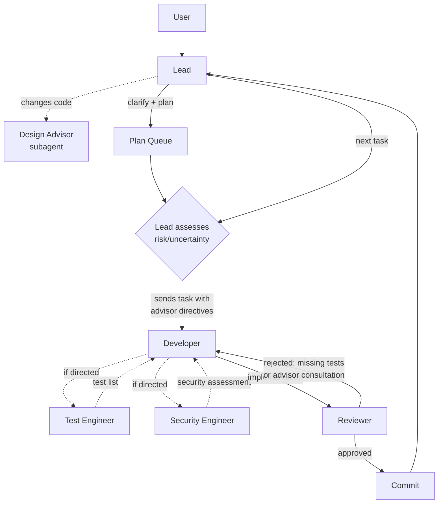
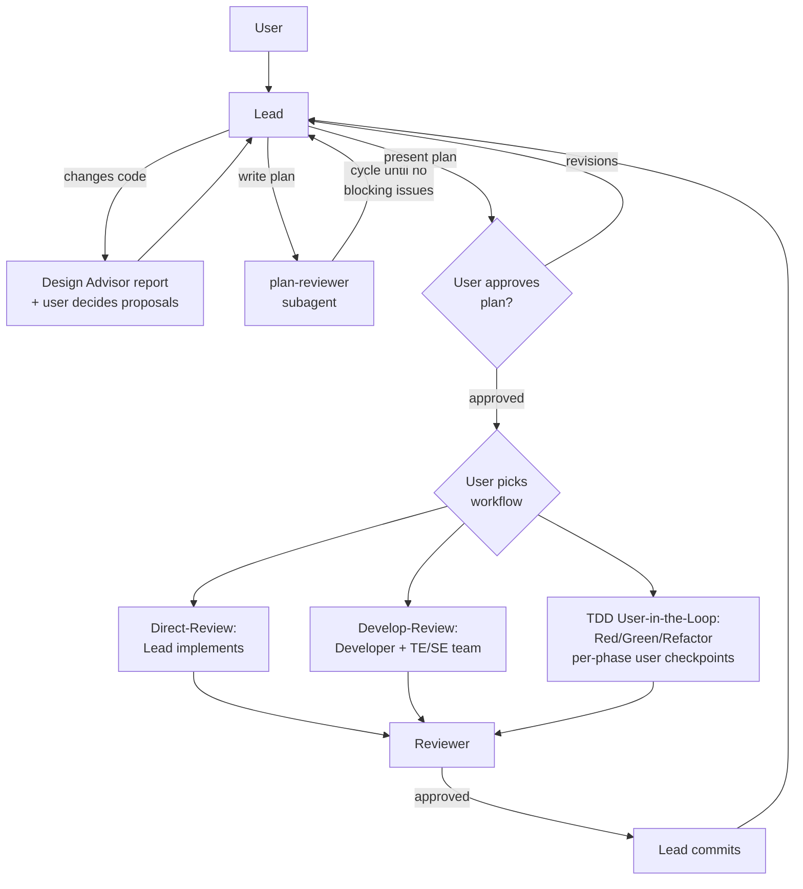
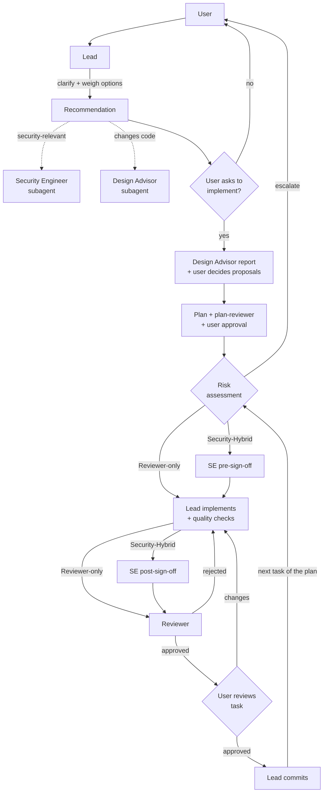

# Claude Orchestration Kit

A toolkit for building Claude Code multi-agent setups.
This repository provides design rules, audit skills, a
test harness, and conventions for creating `.claude/`
configurations — called **blueprints** — that turn a Claude
Code session into a coordinated multi-agent team. Three
production-ready blueprints are included.

## How It Works

The project has two layers:

```text
/.claude/                          ← The toolkit (this repo's tooling)
│   rules/                         ← Design rules for blueprint development
│   skills/                        ← Audit skills (/blueprint-audit, /cache-audit)
│
blueprints/*/                      ← Products of the toolkit
│   .claude/                       ← What gets copied into target projects
│       CLAUDE.md, agents/, rules/, skills/, workflows/
│
devcontainer_templates/            ← Docker sandbox for agent execution
```

**Toolkit** (`/.claude/`) — rules, skills, and conventions
used when building or extending blueprints. Never copied
into target projects.

**Blueprints** (`blueprints/*/.claude/`) — complete agent
setups: lead instructions, agent definitions, rules, skills,
and workflows. Copy one into your project, start Claude Code,
and your session becomes the team lead.

## The Toolkit

The toolkit encodes what makes a blueprint work well —
agent design principles, prompt caching constraints,
terminology standards, and structural tests. It is what
you use when creating a new blueprint or extending an
existing one.

### Design Rules

Rules in `/.claude/rules/` guide blueprint development:

| Rule | Purpose |
|------|---------|
| `agent-design.md` | Agents define role only — no named teammates, no workflow coupling |
| `reasoned-instructions.md` | Include rationale when it changes how an agent applies an instruction |
| `prompt-caching.md` | All static content must respect the cache prefix order |
| `terminology.md` | Official terms: launch subagents, spawn and shut down teammates |
| `handoff-coverage.md` | Every pipeline guarantee needs an owner with sufficient input |
| `simplicity.md` | KISS, YAGNI, fewest elements |
| `behavior-preserving-cuts.md` | Only cut prose that doesn't change agent behavior |
| `instruction-form.md` | Fix timing failures with artifact fields, harness events, or withdrawn authorizations — not more prose |
| `self-check.md` | Post-change verification checklist |
| `hooks-guide.md` | When and how to use Claude Code hooks |

Plus language-specific rules (Python, Go, Rust, TypeScript)
and code quality rules (`code-principles.md`,
`functional-style.md`, `documentation.md`).

### Audit Skills

- **`/blueprint-audit`** — audits a blueprint for
  cross-file consistency, stale references, contradictions,
  rationale completeness, and documentation alignment
- **`/cache-audit`** — checks setup against prompt caching
  best practices (ordering, tool stability, dynamic content)

### Test Harness

Every blueprint has a test suite (`blueprints/*/tests/`)
using pytest with `-m static` markers. Tests verify file
structure, agent frontmatter, caching compliance, settings,
and rule file length. `blueprint_contracts.py` is the
single source of truth for each blueprint's expected
structure.

```bash
which uv || curl -LsSf https://astral.sh/uv/install.sh | sh
uv run pytest blueprints/workflow/tests/ -m static -v
uv run pytest blueprints/autonomous/tests/ -m static -v
uv run pytest blueprints/direct-review/tests/ -m static -v
```

### Extending Blueprints

See [CONTRIBUTING.md](CONTRIBUTING.md) for step-by-step
recipes: adding languages, workflows, agents, skills,
sanity checks, and language-specific init procedures.

## Included Blueprints

| Blueprint | Approach | Agents |
|-----------|----------|--------|
| **autonomous** | Full autonomy after plan approval via a plan queue | Lead, Developer, Reviewer, Test Engineer, Security Engineer, Design Advisor |
| **workflow** | User chooses a workflow after plan approval | Lead, Developer, Test Engineer, Security Engineer, Reviewer, Design Advisor |
| **direct-review** | Advisor by default; lead implements on request with per-task user review | Lead, Reviewer, Security Engineer, Design Advisor |

### When to Use Which

| If you want... | Use |
|---|---|
| Maximum throughput, minimal interaction | autonomous |
| Full autonomy after plan approval | autonomous |
| Plan queue with concurrent clarification | autonomous |
| Lead stays responsive during execution | autonomous |
| Multiple workflow options (supervised, autonomous, TDD) | workflow |
| Per-commit user approval | workflow (Supervised), direct-review |
| An advisor that weighs decisions and edits only when asked | direct-review |
| Lead implements, with security gates on security-relevant work | direct-review |

### Quick Start

```bash
# Copy a blueprint into your project
cp -r blueprints/autonomous/.claude/ /path/to/your/project/.claude/
# or
cp -r blueprints/workflow/.claude/ /path/to/your/project/.claude/
# or
cp -r blueprints/direct-review/.claude/ /path/to/your/project/.claude/
```

Start Claude Code in your project directory. The CLAUDE.md
loads automatically and configures your session as the team
lead.

Agent teams are an experimental Claude Code feature,
disabled by default. Each blueprint's `settings.json`
enables them automatically. You can also set the environment
variable directly:

```bash
export CLAUDE_CODE_EXPERIMENTAL_AGENT_TEAMS=1
```

### autonomous — Plan Queue + Developer

The lead handles clarification, planning, and plan queue
management. Every plan that changes code rests on a Design
Advisor report whose proposals the user decides before the
plan is written; adopted refactors become tasks ahead of the
feature work, preceded by tests that pin the behavior when
none exist. For each task, the lead assesses risk and
uncertainty at dispatch time and directs the Developer to
consult advisors when warranted. The lead stays responsive
to the user during execution — new requests become plans in
the queue.

**Agents:**

| Agent | Model | Role |
|-------|-------|------|
| Lead | Opus | Clarifies task, writes plans, manages plan queue |
| Developer | Sonnet | Implements all code (source + tests) |
| Reviewer | Opus | Quality gate — scope verification, code review |
| Test Engineer | Sonnet | Advisory — test lists on demand |
| Security Engineer | Sonnet | Advisory — security assessments on demand |
| Plan Reviewer (subagent) | Sonnet | Reviews draft plans before user presentation — three focused reviewers in parallel, then follow-up passes on the diff of each revision |
| Design Advisor (subagent) | Opus | Proposes the change's shape, preparatory refactors, and larger redesigns |



The Reviewer provides a backstop: non-trivial behavioral
changes without tests or advisor consultation are rejected.
The Developer-Reviewer rejection loop is opaque to the lead.

### workflow — Clarify-First

The lead clarifies the task, writes a plan (reviewed by the
plan-reviewer subagent and approved by the user), then
presents workflow options. Every plan that changes code
rests on a Design Advisor report whose proposals the user
decides before the plan is written; adopted refactors
become tasks ahead of the feature work. The user chooses how work gets
done. Workflows are separate files in `.claude/workflows/` —
adding one requires no changes to CLAUDE.md.

**Agents:**

| Agent | Model | Role |
|-------|-------|------|
| Lead | Opus | Clarifies task, writes plan, presents workflow options, coordinates |
| Developer | Sonnet | Implements all code (source + tests) |
| Test Engineer | Sonnet | Advisory — designs test specs, verifies coverage |
| Security Engineer | Sonnet | Advisory — checks security gaps |
| Reviewer | Opus | Quality gate — reviews and proposes commit message; lead commits |
| Plan Reviewer (subagent) | Sonnet | Reviews draft plans before user presentation — three focused reviewers in parallel, then follow-up passes on the diff of each revision |
| Test List (subagent) | Sonnet | Converts an example mapping into a minimum required test list (used by `/test-list`) |
| Design Advisor (subagent) | Opus | Proposes the change's shape, preparatory refactors, and larger redesigns |

**Workflows:**

- **Direct-Review** — lead implements the approved plan
  directly, Reviewer checks quality. For well-scoped tasks.
- **Develop-Review (Supervised)** — full dev cycle with
  test-list-driven development and user approval per
  commit.
- **Develop-Review (Autonomous)** — same as Supervised but
  the lead commits automatically after Reviewer approval,
  with no per-commit user checkpoint.
- **TDD User-in-the-Loop** — strict Red-Green-Refactor with
  user approval at every phase transition.



Planning is shared across all workflow variants — the
plan-reviewer cycle and user plan approval happen *before*
workflow selection, so workflow choice is orthogonal to
plan content. Per-commit user approval applies to
Direct-Review, Develop-Review (Supervised), and TDD;
Develop-Review (Autonomous) commits as soon as the
Reviewer approves.

**Skills:**

- **`/project-init`** — scans the project, generates
  `CLAUDE.md` context (overview, build commands, project
  language, conventions, references), and enables the language
  server plugin for each detected language. Run on first
  session.
- **`/project-sanity`** — audits the repository for
  common issues across detected technologies
  (report-only).
- **`/example-mapping`** — facilitates an interactive
  Example Mapping session and writes a structured
  mapping file. Use as the upstream input for
  `/test-list`, or as clarification context for any
  workflow.
- **`/test-list`** — TDD entry path; converts an example
  mapping into a minimum-required test list embedded in
  the plan. Filters subsequent workflow selection to the
  TDD variants.

Language-specific guidance loads automatically via
conditional rules when agents touch matching files.

### direct-review — Advisor First

The lead is an advisor by default: it clarifies the
request, weighs the options with their trade-offs, and
recommends — without editing files. For security-relevant
decisions it consults the Security Engineer as a stateless
subagent; for options that change code, the Design Advisor
(also a stateless subagent) proposes a better shape for the
change, preparatory refactors, and larger redesigns, so they
become options before the user decides. Only an explicit
"implement it" enters Implement mode: every plan that
changes code rests on a Design Advisor report whose
proposals the user has decided; adopted refactors become
tasks ahead of the feature work, preceded by tests that pin
the behavior when none exist. The lead writes the plan
(reviewed by the plan-reviewer subagent and approved by the
user), then implements one task at a time and waits for the
user's review after each.

Each task is classified by `risk-assessment.md`:

- **Reviewer-only** — no security relevance, and existing
  tests cover the change (or it is non-behavioral).
- **Security-Hybrid** — security-relevant work: the
  Security Engineer signs off before any edit and again on
  the final diff.
- **Escalate** — high-risk categories (auth, secrets,
  new input sources, untrusted dynamic construction,
  cross-scope effects) or behavioral changes without
  covering tests. The lead stays in advise mode until the
  user explicitly chooses Security-Hybrid anyway or
  handling the task outside the blueprint.

**Agents:**

| Agent | Model | Role |
|-------|-------|------|
| Lead | Opus | Advises, plans, implements on request, commits after user review |
| Reviewer | Opus | Quality gate — scope, code review, proposes commit message |
| Security Engineer | Opus | Advisory — decision consultations, pre/post-implementation sign-offs |
| Plan Reviewer (subagent) | Sonnet | Reviews draft plans before user presentation — three focused reviewers in parallel, then follow-up passes on the diff of each revision |
| Design Advisor (subagent) | Opus | Proposes the change's shape, preparatory refactors, and larger redesigns |


### Quota Cost Reference

Rough subscription-quota cost of running a blueprint, measured
from local transcripts. Use these figures to judge whether a
plan fits the remaining quota before starting it.

**Calibration.** Dollar figures are API list prices computed
from transcript token counts (Sonnet 5.5: $2 input,
$10 output, $0.20 cache read per MTok; Opus 5.5: $4 input,
$20 output, $0.20 cache read; cache writes cost 1.25× input
for the 5-minute TTL and 2× for the 1-hour TTL). These
dollar figures were mapped to quota using one observed
headless test run: about $85 used roughly 13% of the weekly
quota and nearly filled the 5-hour window. That gives:

| Quota | API-price equivalent |
|---|---|
| 1% of weekly quota | ~$6.5 |
| One 5-hour window | ~$85 (conservative; other sessions shared that window) |

These figures apply to one account plan and the model prices
above. Re-derive them if either changes.

**Plan-review** (Sonnet 5.5 `plan-reviewer`, Opus 5.5 lead;
202 rounds across 16 review cycles):

| Unit | Cost | Weekly | 5-hour |
|---|---|---|---|
| One reviewer launch | $0.73 (IQR $0.50–1.03) | 0.1% | 0.9% |
| Lead triage and plan revision between rounds | $0.53 (IQR $0.36–0.81) | 0.1% | 0.6% |
| One full round (reviewer + lead) | $1.35 (IQR $1.0–1.7) | 0.2% | 1.6% |
| Plan written → approved, 5 rounds | ~$7 | ~1% | ~8% |
| Plan written → approved, 10 rounds | ~$13.5 | ~2% | ~16% |
| Observed cycles (median 10.5 rounds) | median $19, range $4–33 | ~3% | ~23% |

Cost per round stays flat across rounds, so the total grows
linearly with the round count. Observed cycles cost more than
10 × the round median because some rounds include longer
lead discussion with the user.

**Task execution** (one 6-task frontend plan; Sonnet 5
developer and test engineer, Opus 5 reviewer and lead, priced
at 5.5 rates; a single plan, so treat these figures as
indicative):

| Unit | Cost | Weekly | 5-hour |
|---|---|---|---|
| One task (developer + reviewer + test engineer + lead share) | $6–16, median ~$10 | 1–2.5% | 7–19% |
| Whole plan: 6 tasks plus plan-review and wrap-up | ~$78 | ~12% | ~90% |

The lead is the largest single cost (38% of the execution
session). Its context is never reset, so it grew from 130k
to 480k tokens and each lead call got more expensive as tasks
accumulated. Teammates are replaced per task and their cost
tracks task complexity instead. Budget about six to eight
tasks of this size per 5-hour window, fewer if other sessions
run concurrently.

**Experiments that replay transcripts** through headless
`claude -p` cost far more per hour than normal development.
See the cost table in `CLAUDE.md` before running one.

#### Trivial Reference

Same calibration, applied to two other common workloads.

**`/advance-plan` (single-agent plan execution).** The lead
implements each task itself and launches one Sonnet
adversarial-review subagent per task. The skill stops after
one or two tasks, so each session is about two tasks. Sample:
68 sessions; review subagents account for 20–24% of the cost.

| Lead model | Per task | Weekly | 5-hour | Per session (~2 tasks) |
|---|---|---|---|---|
| Opus 5.5 (20 sessions) | median $6.1 (IQR $3.7–8.9) | ~0.9% | ~7% | median $10 |
| Opus 5 (48 sessions) | median $10.9 (IQR $7.3–20.9) | ~1.7% | ~13% | median $20 |

Under the same Opus 5 era, a single-agent task (median $10.9)
cost about as much as a team-pipeline task (median ~$10).
Opus 5.5 sessions are cheaper. The outliers reached $50 per
task, in sessions where the lead kept working long after its
review finished.

**chrome-devtools MCP.** Sample: 707 calls and 49 user
prompts that used the browser.

| Unit | Cost | Weekly | 5-hour |
|---|---|---|---|
| One tool call (the model step that reads its result) | median $0.067 (IQR $0.05–0.09) | ~0.01% | ~0.08% |
| One user prompt that drives the browser (median 7 calls, p90 53) | median $1.8 (IQR $0.7–4.0, p90 $9.2) | ~0.3% (p90 1.4%) | ~2% (p90 11%) |

A call adds only about 1k new tokens (p90 3k; a `take_snapshot`
of a large page reaches 9k). Its cost comes from re-reading the
session context, which had a median of 210k tokens when each
call was made. A call is therefore cheap in a fresh session and
gets more expensive as the conversation grows. Long `evaluate_script`
loops (482 of the 707 calls) are the usual source of p90 prompts.

## Devcontainer Templates

`devcontainer_templates/` provides Docker-based sandboxes
for running agents in isolation. Two variants are available:

| Template | Directory | Platform |
|----------|-----------|----------|
| **Base** | `.devcontainer/` | Cross-platform |
| **Audio** | `.devcontainer_audio/` | Linux (PulseAudio passthrough) |

```bash
# Copy into your project
cp -r devcontainer_templates/.devcontainer/ /path/to/your/project/.devcontainer/
```

**Features:**

- **Dual auth mode** — OAuth (default) or proxy, controlled
  by `CLAUDE_AUTH` in `.devcontainer/.env.local`
- **Scoped network proxy** — build-time (`apt-get`, install
  scripts) proxies via `devcontainer.json`'s `build.args`;
  at runtime, `claude` runs through `claude-proxy.sh`, which
  routes only Claude Code's own traffic through a local
  SOCKS/HTTP proxy. Every other runtime command (DB clients,
  `redis-cli`, etc.) uses the container's default network
  path, riding the host's system network settings (e.g. a
  company VPN)
- **Project-scoped volume** — Claude config and history
  isolated per project
- **Host config as template** — `~/.claude/` mounted
  read-only, copied into container on startup; OAuth
  credentials are never copied — each container logs in once
- **Latest Claude Code on start** — `claude update` runs on
  every start, so the first session needs no restart to
  pick up an update
- **Plugins ready on start** — official plugins the project
  enables are installed automatically; the TypeScript and
  Python language servers are preinstalled

See each template's README for auth configuration,
troubleshooting, and mount details.

Running `blueprints/autonomous` inside a devcontainer is
recommended — the lead commits without per-task user
checkpoints, so container-scoped file writes and git state
contain the blast radius of an unwanted change to the
sandbox, not the host checkout.

## Contributing

See [CONTRIBUTING.md](CONTRIBUTING.md) for how to develop
and extend blueprints — adding languages, workflows, agents,
skills, and running the test suite.

## Known Limitations

Agent teams are experimental. Be aware of:

- **No session resumption** — `/resume` and `/rewind` do
  not restore in-process teammates; the lead spawns them
  again.
- **One team per session** — the team forms implicitly
  when the lead spawns its first teammate and is cleaned
  up when the session ends. There is no separate
  create or delete step; to start fresh, the lead shuts
  down its teammates and spawns new ones.
- **No nested teams** — only the lead can manage the team.
- **Lead is fixed** — the main session stays the lead for
  its lifetime.
- **Permission mode inherits** — all teammates start with
  the lead's permission mode (e.g., whether tool use
  prompts for approval). Agent `tools:` frontmatter
  independently restricts which tools each agent can use.
